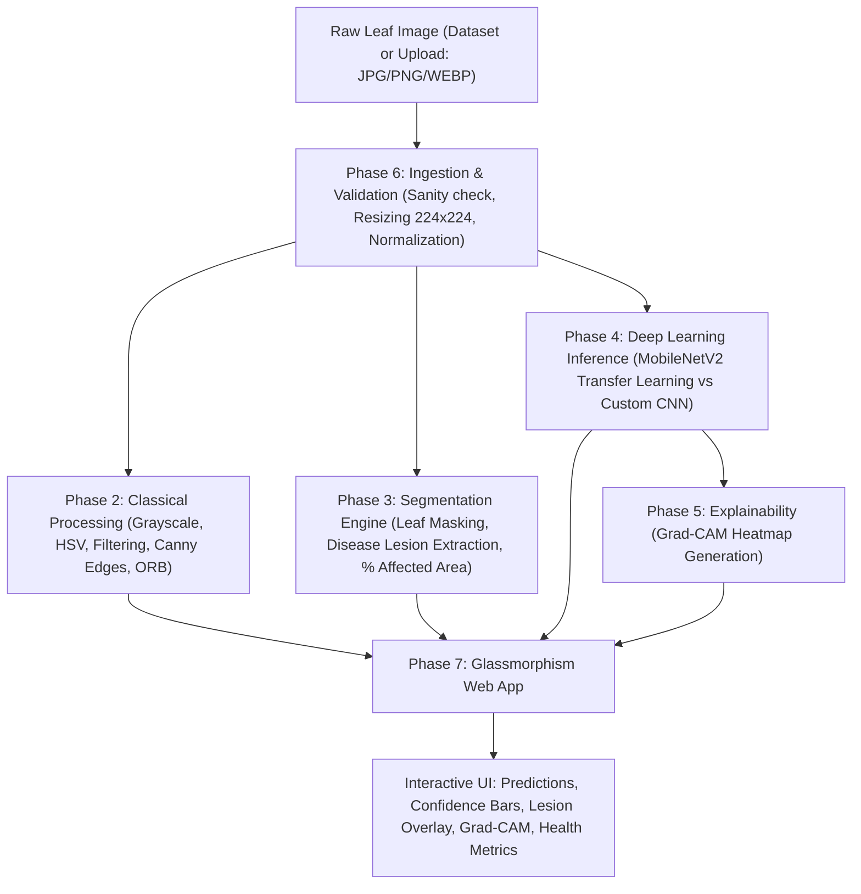

# 🌿 Plant Leaf Disease Detection & Segmentation System
### An End-to-End Computer Vision & Deep Learning Pipeline with Apple-Style Glass UI

---

## 📌 Executive Summary
This project is an end-to-end Computer Vision system designed for academic evaluation (CIA Labs / Mini Project, 20 Marks, Practical No. 11 covering CO1 to CO5). The system accepts plant leaf images, applies classical image processing techniques, segments diseased lesions to quantify damaged leaf area percentage, classifies leaf health and disease types using a lightweight deep learning architecture (**MobileNetV2** vs baseline CNN), visualizes model decision regions via **Grad-CAM**, and serves the entire pipeline through an **Apple-style Glassmorphism local web UI**.

---

## 🎯 Syllabus & Course Outcomes (CO) Alignment

| Unit & Focus | Course Outcome (CO) | Practical Mapping | Implementation in Project |
| :--- | :--- | :--- | :--- |
| **Unit I: Digital Image Fundamentals** | **CO1:** Understand image acquisition, color spaces, transformations | Practical 2 | RGB to Grayscale, HSV conversion, image resizing, color histogram analysis |
| **Unit II: Image Enhancement & Filtering** | **CO2:** Apply spatial filtering, edge detection, feature extraction | Practicals 3, 4 | Gaussian/Median smoothing, Histogram Equalization (CLAHE), Sobel & Canny edge detection, ORB keypoint matching |
| **Unit III: Image Segmentation** | **CO3:** Segment regions of interest & extract morphological features | Practical 5 | Leaf-from-background isolation, K-Means / HSV disease thresholding, lesion contour detection, leaf surface area % affected |
| **Unit IV: Deep Learning Classification** | **CO4:** Train & evaluate CNN models with transfer learning | Practicals 7, 8 | 1) Baseline custom CNN architecture<br>2) MobileNetV2 Transfer Learning (fine-tuned)<br>Data augmentation, Confusion Matrix, Precision/Recall/F1 |
| **Unit V: Modern CV & Explainability** | **CO5:** Advanced CV techniques & interpretability | Practical 9 & 11 | **Grad-CAM** (Gradient-weighted Class Activation Mapping) showing heatmaps of infected regions used by the neural network |

---

## 🏛️ System Architecture Pipeline



---

## 📂 Project Directory Structure

```text
CV_final_project/
├── data/                         # Dataset directory
│   ├── raw/                      # Downloaded PlantVillage subset (e.g., Tomato 5-10 classes)
│   ├── processed/                # Preprocessed train / val / test splits (70 / 15 / 15)
│   └── samples/                  # Curated sample test images for quick offline demos
├── notebooks/                    # Jupyter notebooks for step-by-step academic evaluation
│   ├── 01_data_exploration.ipynb
│   ├── 02_classical_processing.ipynb   # CO1, CO2
│   ├── 03_segmentation_analysis.ipynb   # CO3
│   ├── 04_cnn_baseline_training.ipynb  # CO4
│   ├── 05_mobilenet_transfer.ipynb     # CO4
│   └── 06_gradcam_explainability.ipynb # CO5
├── src/                          # Production modular python package
│   ├── __init__.py
│   ├── config.py                 # Hyperparameters, paths, class labels
│   ├── preprocessing.py          # Classical transformations, CLAHE, filters, edges
│   ├── segmentation.py           # Background subtraction, disease spot extraction, area %
│   ├── dataset.py                # PyTorch/TensorFlow dataset loaders & augmentations
│   ├── models.py                 # Custom CNN architecture & MobileNetV2 fine-tuning wrapper
│   ├── explainability.py         # Grad-CAM implementation
│   └── inference.py              # Unified pipeline: image in -> full analysis output
├── models/                       # Saved trained weights and metrics
│   ├── baseline_cnn.pth (or .keras)
│   ├── mobilenetv2_leaf.pth (or .keras)
│   └── class_indices.json
├── static/                       # Web frontend assets (for Glassmorphic UI)
│   ├── css/
│   │   └── glass.css             # Apple-style backdrop-filter blur, frost gradients
│   └── js/
│       └── app.js                # Asynchronous upload & visualization handlers
├── templates/                    # HTML templates (if FastAPI/Flask UI)
│   └── index.html                # Apple glass aesthetic layout
├── reports/                      # Academic report figures, confusion matrices, CO mapping
├── app.py                        # Local application server entry point
├── PROJECT_OVERVIEW.md           # Project architecture and technical specification
├── PROGRESS.md                   # Phased milestone tracker and log
└── requirements.txt              # Environment dependencies
```

---

## 🔬 Phase Breakdown & Technical Details

### Phase 0: Setup & Environment Initialization ✅ [COMPLETED]
- Configured scientific stack: OpenCV 5.0, NumPy, Matplotlib, Scikit-learn, Pillow, PyTorch 2.15, Torchvision.
- Scaffolded modular directory structure (`data/`, `notebooks/`, `src/`, `models/`, `static/`, `templates/`, `reports/`).

### Phase 1: Dataset Acquisition & Preparation ✅ [COMPLETED]
- Target Dataset: **PlantVillage Multi-Crop Dataset** covering **9 distinct plant species** across **33 disease and healthy classes** (~40,000 raw images):
  - **Apple** (Apple Scab, Black Rot, Cedar Apple Rust, Healthy)
  - **Bell Pepper** (Bacterial Spot, Healthy)
  - **Cherry** (Powdery Mildew, Healthy)
  - **Corn / Maize** (Cercospora Leaf Spot, Common Rust, Northern Leaf Blight, Healthy)
  - **Grape** (Black Rot, Esca Black Measles, Leaf Blight, Healthy)
  - **Peach** (Bacterial Spot, Healthy)
  - **Potato** (Early Blight, Late Blight, Healthy)
  - **Strawberry** (Leaf Scorch, Healthy)
  - **Tomato** (Bacterial Spot, Early Blight, Late Blight, Leaf Mold, Septoria Leaf Spot, Spider Mites, Target Spot, Mosaic Virus, Yellow Leaf Curl, Healthy)
- Automated downloader and splitter script to partition data into `train (70%)`, `val (15%)`, `test (15%)`.
- Class & plant species distribution visualization and balance verification (`reports/plant_species_distribution.png` and `reports/class_distribution.png`).

### Phase 2: Classical Image Processing (CO1 & CO2) ✅ [COMPLETED]
- **Color Spaces**: RGB $\rightarrow$ Grayscale, RGB $\rightarrow$ HSV (Hue separation for chlorophyll vs necrosis/lesions).
- **Enhancement**: Contrast Limited Adaptive Histogram Equalization (**CLAHE**), Bilateral & Gaussian filtering.
- **Edge Detection**: Sobel directional gradients and Canny edge detector on leaf margins and vein structures.
- **Feature Matching**: ORB (Oriented FAST and Rotated BRIEF) feature descriptors and keypoints visualization.
- Generated and saved 5 comprehensive multi-panel academic comparison figures in `reports/classical_*.png`.

### Phase 3: Segmentation & Severity Quantification (CO3) ✅ [COMPLETED]
- **Stage 1 (Leaf Masking)**: Otsu thresholding + Saturation masking + Morphological cleaning to isolate leaf blade from background.
- **Stage 2 (Lesion Segmentation)**: Color thresholding in HSV space isolating brown/yellow necrotic regions and dark fungal lesions.
- **Stage 3 (Quantification)**: Computed mathematical surface area percentage affected:
  $$\text{Disease Severity (\%)} = \frac{\text{Pixel Area of Diseased Lesions}}{\text{Total Pixel Area of Leaf}} \times 100$$
- **Stage 4 (Visual Overlay)**: Glowing neon contours and translucent heat overlays.
- Generated individual crop analysis figures and a multi-crop summary comparison chart in `reports/segmentation_multi_plant_summary.png`.

### Phase 4: Deep Learning Classification (CO3 & CO4) ✅ [COMPLETED]
- **Model 1 (Baseline CNN)**: 4 convolutional blocks (Conv2D $\rightarrow$ BatchNorm $\rightarrow$ ReLU $\rightarrow$ MaxPool) followed by Dense layers. Achieved **73.98% Test Accuracy**.
- **Model 2 (Transfer Learning)**: **MobileNetV2** pre-trained on ImageNet with customized 33-class classification head. Achieved **96.95% Test Accuracy**.
- **Data Augmentation**: Random horizontal/vertical flips, affine rotations ($\pm 15^\circ$), color jitter.
- **Evaluation**: Classification Report (Precision: 97.02%, Recall: 96.97%, F1-Score: 96.96%), Confusion Matrix heatmaps, and CNN vs MobileNetV2 comparison table (`reports/model_comparison_metrics.txt`).

### Phase 5: Modern Techniques & Explainability (CO5) ✅ [COMPLETED]
- **Grad-CAM (Gradient-weighted Class Activation Mapping)**:
  - Hooks into the final convolutional layer of MobileNetV2 (`features[-1]`).
  - Computes gradients of the target class score with respect to feature activation maps.
  - Generates a 2D heatmap overlaid on the leaf, proving the model looks at actual lesions rather than background artifacts (`reports/gradcam_*.png`).

### Phase 6: Ingestion & In-The-Wild Upload Pipeline ✅ [COMPLETED]
- Universal input handler in `src/inference.py` supporting JPG, PNG with alpha, WEBP, BMP.
- Automatic channel normalization (stripping alpha channels, converting grayscale to 3-channel RGB).
- Input sanity verification: Confidence rejection threshold ($< 50\%$ flags out-of-distribution advisory warning).

### Phase 7: Apple-Style Glassmorphism Local UI ✅ [COMPLETED]
- Modern aesthetic inspired by macOS / iOS design guidelines:
  - `backdrop-filter: blur(26px) saturate(190%)`
  - Subtle translucent borders (`1px solid rgba(255, 255, 255, 0.18)`)
  - Smooth box shadows with natural ambient diffusion
  - Apple SF Pro / Inter typography
  - Interactive file dropzone with instant preview
  - Multi-tab visualizer displaying:
    1. AI Diagnosis & Grad-CAM Heatmap
    2. Quantitative Lesion Segmentation & Severity %
    3. Classical CV Explorer (CLAHE, Sobel, Canny, ORB)
- Local Web Server running at `http://127.0.0.1:8000` via `server.py`.

### Phase 8: Academic Report, Viva Prep & Demo Assets ✅ [COMPLETED]
- Comprehensive Viva voce Q&A document at `reports/VIVA_AND_PRACTICAL_RECORD.md`.
- Course Outcome (CO1-CO5) mapping matrix for examiner evaluation.
- 3 interactive academic Jupyter notebooks in `notebooks/` (`01_classical_processing.ipynb`, `02_segmentation_analysis.ipynb`, `03_gradcam_explainability.ipynb`).
- High-resolution comparison plots saved in `reports/` for the final lab manual/report.

