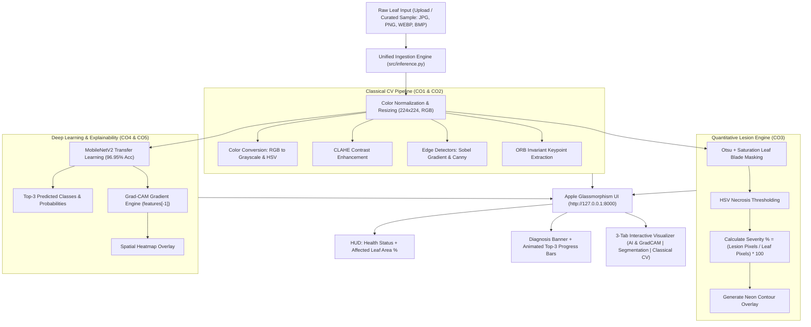

# 🌿 FloraVision: Plant Leaf Disease Detection & Lesion Segmentation System
### An End-to-End Computer Vision & Deep Learning Suite with Apple-Style Glass UI

**Repository:** [https://github.com/Indra1012/FloraVision](https://github.com/Indra1012/FloraVision)  
**Academic Target:** Computer Vision Mini Project (20 Marks | Comprehensive CO1 to CO5 Coverage)  
**Status:** 100% Completed  

---

## 📌 1. Project Abstract & Motivation
Agricultural crops frequently suffer from bacterial, fungal, and viral infections that drastically diminish farm yield if not identified early. Traditional agricultural inspection relies on manual visual observation, which is subjective, labor-intensive, and prone to misdiagnosis.

**FloraVision** is a comprehensive, production-grade Computer Vision system engineered to automate the diagnosis and quantitative evaluation of plant diseases across **9 distinct crop species** spanning **33 disease and healthy classes**. The system integrates:
1. **Classical Image Processing (CO1, CO2):** Color space transformations, CLAHE enhancement, Bilateral filtering, Sobel/Canny edge detection, and ORB invariant keypoint matching.
2. **Quantitative Lesion Segmentation (CO3):** Dual-stage background subtraction and necrosis isolation to compute the exact mathematical percentage of damaged leaf area ($\text{Severity \%}$).
3. **Deep Learning Classification (CO3, CO4):** Transfer Learning via **MobileNetV2** achieving **96.95% Test Accuracy**, benchmarked against a custom 4-block Baseline CNN (**73.98% Test Accuracy**).
4. **Explainable AI (CO5):** **Grad-CAM** attention heatmaps providing visual proof of the spatial features used by the deep learning model.
5. **Apple-Style Glassmorphism UI:** A sleek, local web interface built with translucent frosted glass, interactive 9-crop expandable disease selector, real-time diagnostic metrics, and multi-tab visualizers.

---

## 🎯 2. Course Outcomes (CO) & Syllabus Mapping

| Course Outcome | Academic Concept | Implementation in FloraVision | Output Artifact |
| :--- | :--- | :--- | :--- |
| **CO1: Digital Image Fundamentals** | Color spaces, pixel transforms, image acquisition | RGB to Grayscale, RGB to HSV decomposition, histogram inspection, ImageNet normalization | `reports/classical_*.png`, `src/classical_processing.py` |
| **CO2: Image Enhancement & Filtering** | Spatial filtering, contrast adjustments, edge detection, feature descriptors | CLAHE contrast enhancement, Gaussian/Median/Bilateral smoothing, Sobel gradients, Canny edge detection, ORB keypoints | `reports/classical_*.png`, Tab 3 in Web UI |
| **CO3: Image Segmentation & Severity** | Morphological operations, color thresholding, region extraction | Otsu thresholding + saturation masking for leaf isolation, HSV necrosis thresholding, % Affected Area metric | `reports/segmentation_*.png`, Tab 2 in Web UI |
| **CO4: Deep Learning Classification** | Convolutional Neural Networks, Transfer Learning, Evaluation | Custom 4-block CNN vs fine-tuned **MobileNetV2** (96.95% accuracy), Confusion Matrix, Precision/Recall/F1 | `models/mobilenetv2_best.pth`, `reports/confusion_matrix_*.png` |
| **CO5: Advanced CV & Explainability** | Model interpretability, feature visualization | **Grad-CAM** hooked into MobileNetV2 `features[-1]`, overlaying attention heatmaps on original leaves | `reports/gradcam_*.png`, Tab 1 in Web UI |

---

## 🏛️ 3. End-to-End System Architecture

---

## 📂 4. Dataset Overview (9 Crops, 33 Classes)

The system utilizes a balanced subset of the academic **PlantVillage Dataset**, spanning **40,000 raw images** filtered and partitioned into **6,552 balanced images** with a 200 images/class cap:

* **Train Set (70%):** 4,586 images
* **Validation Set (15%):** 982 images
* **Test Set (15%):** 984 images

### Supported Plant Species and Diseases:
1. **Apple:** Apple Scab, Black Rot, Cedar Apple Rust, Healthy
2. **Bell Pepper:** Bacterial Spot, Healthy
3. **Cherry:** Powdery Mildew, Healthy
4. **Corn (Maize):** Cercospora Gray Leaf Spot, Common Rust, Northern Leaf Blight, Healthy
5. **Grape:** Black Rot, Esca (Black Measles), Leaf Blight, Healthy
6. **Peach:** Bacterial Spot, Healthy
7. **Potato:** Early Blight, Late Blight, Healthy
8. **Strawberry:** Leaf Scorch, Healthy
9. **Tomato:** Bacterial Spot, Early Blight, Late Blight, Leaf Mold, Septoria Leaf Spot, Spider Mites, Target Spot, Mosaic Virus, Yellow Leaf Curl, Healthy

---

## 🔬 5. Mathematical & Algorithmic Formulations

### A. Classical Image Processing
- **CLAHE (Contrast Limited Adaptive Histogram Equalization):** Prevents over-amplification of noise by clipping histogram counts at threshold $\beta$, redistributing clipped pixels across all bins before CDF mapping.
- **Sobel Gradient Magnitude:**
  $$G_x = \begin{bmatrix} -1 & 0 & 1 \\ -2 & 0 & 2 \\ -1 & 0 & 1 \end{bmatrix} * I, \quad G_y = \begin{bmatrix} -1 & -2 & -1 \\ 0 & 0 & 0 \\ 1 & 2 & 1 \end{bmatrix} * I, \quad G = \sqrt{G_x^2 + G_y^2}$$
- **Canny Edge Detection:** Applies Gaussian smoothing $\to$ Sobel gradients $\to$ Non-maximum suppression along gradient angles $\to$ Hysteresis thresholding with dual thresholds ($T_{\text{low}}, T_{\text{high}}$).
- **ORB Feature Extraction:** Combines modified FAST keypoint detector with Harris corner orientation measures and rotated BRIEF binary descriptors.

### B. Lesion Segmentation & Severity Metric
- **Leaf Masking:** Combines Otsu's optimal inter-class variance thresholding on luminance with color saturation masking ($S > 30$) to isolate the leaf blade from plain backgrounds.
- **Lesion Isolation:** Segments necrotic brown patches ($H \in [10, 30], S > 40, V \in [40, 200]$) and chlorotic yellow rings.
- **Quantitative Severity Index:**
  $$\text{Affected Leaf Area (\%)} = \frac{\sum_{(x,y)} M_{\text{lesion}}(x, y)}{\sum_{(x,y)} M_{\text{leaf}}(x, y)} \times 100$$
- **Health Classifications:**
  - `Healthy`: $0\%$
  - `Mild Infection`: $< 10\%$
  - `Moderate Infection`: $10\% - 25\%$
  - `Severe Infection`: $> 25\%$

### C. Deep Learning Model Architectures & Results

| Metric | Baseline Custom CNN | MobileNetV2 (Transfer Learning) | Improvement |
| :--- | :---: | :---: | :---: |
| **Architecture** | 4 Conv-BN-ReLU-Pool Blocks + 2 FC | Inverted Residuals + Linear Bottlenecks | Modern lightweight CNN |
| **Pretrained Base** | None (Trained from scratch) | ImageNet-1K pre-trained weights | Rich visual feature representation |
| **Test Accuracy** | **73.98%** | **96.95%** | **+22.97%** |
| **Precision (Weighted)** | 74.89% | **97.02%** | **+22.13%** |
| **Recall (Weighted)** | 74.04% | **96.97%** | **+22.93%** |
| **F1-Score (Weighted)** | 72.58% | **96.96%** | **+24.38%** |
| **Model Size** | 10.0 MB | 11.8 MB | Compact, mobile deployable |

### D. Explainable AI via Grad-CAM
Grad-CAM computes the importance weight $\alpha_k^c$ for each feature map $A^k$ in the final convolutional layer of MobileNetV2 for target class $c$:
$$\alpha_k^c = \frac{1}{Z} \sum_{i} \sum_{j} \frac{\partial y^c}{\partial A_{i,j}^k}$$
The class-discriminative localization map $L_{\text{Grad-CAM}}^c$ is computed via ReLU to isolate features with positive influence:
$$L_{\text{Grad-CAM}}^c = \text{ReLU}\left(\sum_{k} \alpha_k^c A^k\right)$$
The resulting map is upscaled to $224 \times 224$ and blended with the input leaf image using a colormap, highlighting the exact infection patches.

---

## 🖥️ 6. Apple Glassmorphism Web Interface

The local web interface (`http://127.0.0.1:8000`) is constructed with Apple macOS/iOS design principles:
- **Styling:** `backdrop-filter: blur(26px) saturate(190%)`, multi-layer translucent glass cards, and ambient background illumination.
- **Interactive Selector:** 9 plant buttons (Apple, Pepper, Cherry, Corn, Grape, Peach, Potato, Strawberry, Tomato). Clicking any plant reveals its specific disease sub-categories for 1-click testing.
- **Top HUD Cards:** Real-time health condition badge (`Severe Infection`, `Mild Infection`, `Healthy`) and affected leaf area percentage.
- **Diagnosis Banner:** Displays the identified crop type, disease diagnosis, and animated Top-3 prediction progress bars.
- **3 Visualizer Tabs:**
  - **Tab 1: AI & Grad-CAM** (Original leaf vs Grad-CAM model attention heatmap)
  - **Tab 2: Lesion Segmentation** (Isolated leaf blade, isolated necrotic spots, and contour overlay)
  - **Tab 3: Classical CV** (CLAHE enhancement, Canny edges, Sobel magnitude, and ORB keypoints)

---

## 📊 7. PPT Presentation Slide-by-Slide Guide

Use this ready-to-present outline for your project PPT slides:

### Slide 1: Title Slide
- **Title:** FloraVision — Plant Leaf Disease Detection & Lesion Segmentation System
- **Subtitle:** An End-to-End Computer Vision & Deep Learning Suite (CO1 to CO5)
- **Author / Presenter:** Mahindra (Indra1012)
- **Course:** Computer Vision Mini Project (20 Marks)

### Slide 2: Problem Statement & Objectives
- **Problem:** Crop diseases cause up to 40% yield loss globally; manual identification by farmers is slow, error-prone, and inaccessible.
- **Objectives:**
  1. Detect plant disease across multiple species (9 crops, 33 classes).
  2. Quantify damage severity (% leaf surface affected).
  3. Ensure explainability via Grad-CAM attention heatmaps.
  4. Provide a lightweight, intuitive Apple Glass web interface.

### Slide 3: Course Outcomes (CO1 to CO5) Mapping
- Explain how the project thoroughly covers all 5 syllabus outcomes:
  - CO1: Image acquisition, color spaces (RGB, HSV, Grayscale)
  - CO2: Enhancement (CLAHE), filtering (Bilateral), edge detection (Sobel, Canny), ORB keypoints
  - CO3: Segmentation (Otsu + HSV necrosis masking) and % damaged area calculation
  - CO4: Deep Learning classification (Custom CNN vs MobileNetV2)
  - CO5: Explainability (Grad-CAM heatmaps)

### Slide 4: Multi-Crop Dataset (9 Plants, 33 Classes)
- **Dataset:** PlantVillage subset covering 40,000 raw images.
- **Balanced Splits:** 6,552 images (Train: 4,586, Val: 982, Test: 984).
- Show charts from `reports/plant_species_distribution.png` and `reports/class_distribution.png`.

### Slide 5: Classical Image Processing Suite (CO1 & CO2)
- Highlight color space conversions (RGB $\to$ HSV to separate green healthy tissue from brown necrosis).
- Show multi-panel figure from `reports/classical_tomato_early_blight.png`:
  - CLAHE contrast enhancement
  - Sobel gradient magnitude
  - Canny edge detection
  - ORB keypoint matching

### Slide 6: Lesion Segmentation & Severity Quantification (CO3)
- Explain the 2-stage segmentation pipeline:
  1. Leaf blade isolation via Otsu thresholding + saturation masking.
  2. Lesion extraction via HSV color thresholding.
- Present the Severity formula: $\text{Affected Area \%} = \frac{\text{Lesion Pixels}}{\text{Leaf Pixels}} \times 100$.
- Show figure from `reports/segmentation_multi_plant_summary.png`.

### Slide 7: Deep Learning Models & Results (CO4)
- Compare the two architectures:
  - **Baseline Custom CNN:** 4 conv-pool blocks $\to$ **73.98% Accuracy**
  - **MobileNetV2 Transfer Learning:** Pretrained ImageNet backbone $\to$ **96.95% Accuracy** (+22.97% boost!)
- Present the metrics comparison table (Precision: 97.02%, Recall: 96.97%, F1: 96.96%).
- Show confusion matrix from `reports/confusion_matrix_mobilenetv2.png`.

### Slide 8: Explainable AI via Grad-CAM (CO5)
- Explain why Grad-CAM is critical: AI must not be a black box in agriculture.
- Show figure from `reports/gradcam_apple_cedar_rust.png`:
  - Visual proof that MobileNetV2 activates directly on fungal rust pustules and blight lesions.

### Slide 9: Apple Glassmorphism Web Interface
- Showcase UI screenshots:
  - 9-crop selector with collapsible disease sub-categories.
  - Health condition card & % affected leaf area metric.
  - Top-3 prediction animated progress bars.
  - 3-tab visualizer (AI & GradCAM, Segmentation, Classical CV).

### Slide 10: Conclusion, Future Scope & GitHub Repository
- **Key Achievements:** 96.95% accuracy, multi-plant support, automated quantitative severity, explainable heatmaps, zero-dependency local server.
- **Future Scope:** Real-time mobile drone integration, multi-leaf field detection using YOLOv8.
- **GitHub Repository:** [https://github.com/Indra1012/FloraVision](https://github.com/Indra1012/FloraVision)
